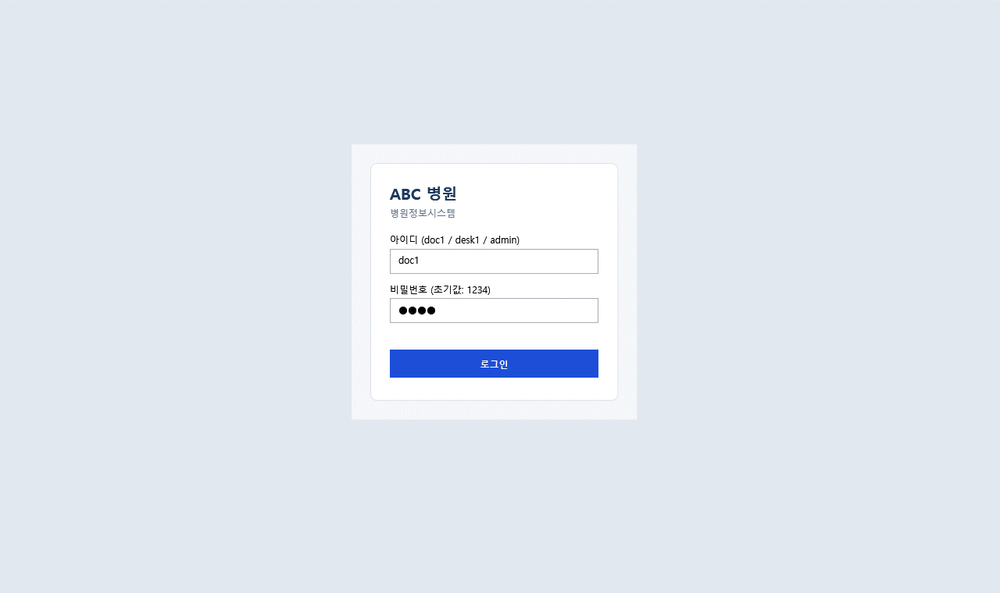

# HIS Soultion (병원정보시스템)

C#(.NET 8), WPF(MVVM), `DevExpress.Mvvm`, MSSQL(Dapper)을 활용하여 **외래 접수 → 진료/처방(EMR·OCS) → 수납 → 수납 이력/엑셀 내보내기 → 감사 로그**까지 병원 핵심 업무 흐름을 구현한 포트폴리오 프로젝트입니다.



---

## 1. 주요 기능

### ① 인증 · 보안 · 세션 관리
- **SHA-256 비밀번호 해시 검증** 및 역할(`Admin`, `Doctor`, `Nurse`, `Desk`) 관리
- **중복 로그인 제어**: `dbo.Users.ActiveSessionToken` 기반으로 다른 위치에서 동일 계정 로그인 시 확인 팝업을 띄우고, 강제 로그인 시 기존 세션 자동 로그아웃 처리
- **로그인 유지 시간 관리**: [appsettings.json](src/HIS.WPF/appsettings.json) (`Auth:SessionTimeoutMinutes`, 기본 60분) 설정, 상단 헤더 실시간 남은 시간(`MM:SS`) 표시, 연장 버튼 및 만료 시 자동 로그아웃

### ② 1. 외래 접수 / 원무 (`ReceptionView`)
- 차트번호·성명·연락처 기반 환자 검색
- 신환 등록 시 차트번호 자동 채번(`P2026xxxx`) 및 주민등록번호 마스킹(`900101-1******`) 저장
- 담당 의사 배정 및 당일 외래 접수 등록(`Wait` 상태)

### ③ 2. 진료 / EMR · OCS (`EmrView`)
- 대기 환자 선택 시 진료 시작 전환(`Wait → InCare`) 및 `RowVer` 기반 낙관적 동시성 제어
- KCD 주상병 선택, 바이탈 사인(혈압·체온) 입력, SOAP 차트 기록
- 약품·검사·처치 처방 오더 입력 및 용량/횟수/일수 편집
- 단일 DB 트랜잭션으로 진료기록·처방·바이탈 저장 후 수납대기(`PayWait`) 전환

### ④ 3. 진료비 수납 (`BillingView`)
- 처방 오더 기반 총 진료비·급여·비급여 자동 집계
- 보험유형별 본인부담률 적용(건강보험 30%, 의료급여 10%, 일반 100%, 10원 미만 절사)
- 수납 완료(`Done`) 처리 및 영수증 번호(`RCP-YYYYMMDD-xxxx`) 생성

### ⑤ 4. 수납 내역 이력 & 엑셀 다운로드 (`PaymentHistoryView`)
- 기간·결제수단·환자명/차트번호/영수증번호 조건 검색 및 건수/금액 합계 요약
- 선택 수납 건의 상세 처방 내역 조회
- **ClosedXML 엑셀(`.xlsx`) 다운로드**: 다운로드 사유 필수 입력 팝업([ExcelExportReasonDialog](src/HIS.WPF/Views/ExcelExportReasonDialog.xaml))을 거쳐 파일 저장 후 **계정 정보·사유·건수**를 감사 로그에 자동 기록

### ⑥ 5. 감사 로그 (`AuditLogView`)
- 로그인, 로그아웃, 엑셀 다운로드, EMR 조회/등록/수정 이력 기록(`dbo.AuditLogs`)
- 기간·이력 구분·검색어 조건 필터 및 상단 빠른 조회 메뉴(`로그인 이력`, `로그아웃 이력`, `엑셀 다운로드 이력` 등) 제공

---

## 2. 솔루션 구조 (계층형 아키텍처)

```text
HIS.sln                         # Visual Studio 2022 이상 호환 솔루션
├── database/
│   ├── 01_schema.sql           # HIS_SYSTEM DB 및 13개 테이블/인덱스 DDL
│   └── 02_seed.sql             # 공통코드, 테스트 계정, KCD/수가 마스터, 샘플 환자/접수 데이터
└── src/
    ├── HIS.Core/               # 도메인 Entity(11개), Enum, 보안 유틸(SecurityHelper)
    ├── HIS.Data/               # IDbConnectionFactory, 기능별 Dapper Repository(7개)
    ├── HIS.Services/           # 비즈니스 로직, 트랜잭션 조율, SessionContext
    └── HIS.WPF/                # MVVM UI (Views, ViewModels, DI, ClosedXML)
```

---

## 3. 기술 스택

| 구분 | 기술 / 라이브러리 |
| :--- | :--- |
| **Language / Runtime** | C# 12 / .NET 8 (`net8.0-windows`) |
| **UI / MVVM** | WPF, `DevExpress.Mvvm` (`ViewModelBase`, `AsyncCommand`, `DelegateCommand`) |
| **Database / ORM** | Microsoft SQL Server (MSSQL), `Dapper`, `Microsoft.Data.SqlClient` |
| **DI / Config** | `Microsoft.Extensions.DependencyInjection`, `Microsoft.Extensions.Configuration.Json` |
| **Excel Export** | `ClosedXML` |

---

## 4. 실행 방법

### 1) 데이터베이스 구축 (로컬 SQL Server)
```powershell
sqlcmd -S . -E -C -f 65001 -i "database\01_schema.sql"
sqlcmd -S . -E -C -f 65001 -i "database\02_seed.sql"
```

### 2) 연결 문자열 및 세션 시간 확인 (`src/HIS.WPF/appsettings.json`)
```json
{
  "ConnectionStrings": {
    "HisDb": "Server=.;Database=HIS_SYSTEM;Trusted_Connection=True;TrustServerCertificate=True;"
  },
  "Auth": {
    "SessionTimeoutMinutes": 60
  }
}
```

### 3) 빌드 및 실행
```powershell
dotnet build HIS.sln
dotnet run --project src/HIS.WPF/HIS.WPF.csproj
```
- Visual Studio 2022 이상에서는 [HIS.sln](HIS.sln)을 열어 `HIS.WPF`를 시작 프로젝트로 실행할 수 있습니다.
- **테스트 계정** (비밀번호 공통: `1234`): `doc1` (의사), `desk1` (원무), `admin` (관리자)
